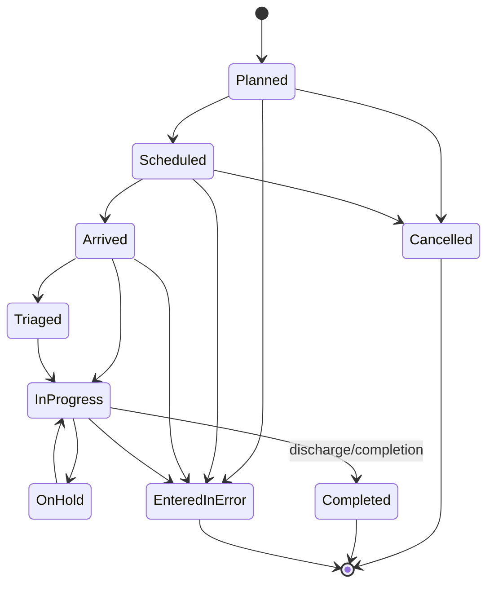
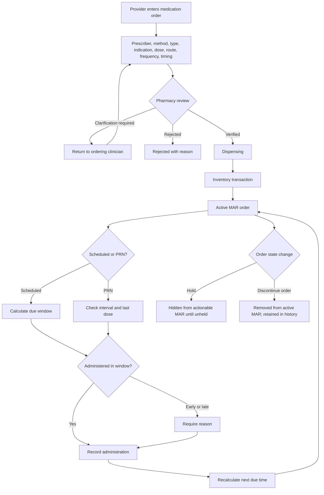
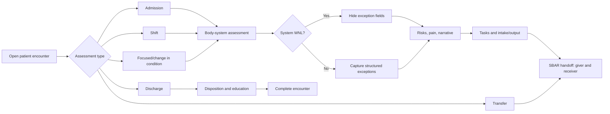
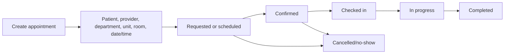
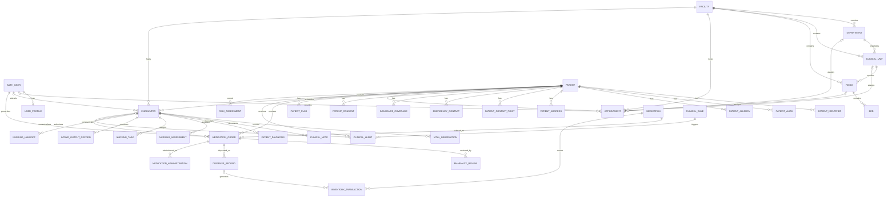

# Liberia EHR

Liberia EHR is a modular, server-rendered electronic health record under active development. It combines longitudinal patient records, encounter-based clinical workflows, nursing documentation, medication ordering and administration, pharmacy operations, scheduling, and operational analytics in a compact Django interface.

> [!WARNING]
> This project is not certified or validated for production clinical use. Do not load real protected health information until security, privacy, clinical-safety, backup, recovery, and regulatory reviews are complete.

## Contents

- [Project status](#project-status)
- [Implemented workflows](#implemented-workflows)
- [Clinical workflow diagrams](#clinical-workflow-diagrams)
- [Architecture](#architecture)
- [Technology stack](#technology-stack)
- [Repository layout](#repository-layout)
- [Domain model](#domain-model)
- [Database relationships](#database-relationships)
- [Application catalog](#application-catalog)
- [Permissions and access control](#permissions-and-access-control)
- [State, audit, and record lifecycle](#state-audit-and-record-lifecycle)
- [Navigation and application areas](#navigation-and-application-areas)
- [Installation](#installation)
- [Configuration](#configuration)
- [Running the application](#running-the-application)
- [Development workflow](#development-workflow)
- [Testing](#testing)
- [Security and clinical safety](#security-and-clinical-safety)
- [Deployment](#deployment)
- [Known limitations](#known-limitations)
- [Roadmap](#roadmap)
- [Documentation](#documentation)

## Project status

- **Status:** active development
- **Framework:** Django 5.x
- **Default development database:** SQLite
- **Recommended production database:** PostgreSQL
- **Application timezone:** `America/Chicago` (Iowa local time)
- **UI model:** Django templates + HTMX + Alpine.js + Tailwind CSS

The repository contains both operational workflows and scaffold applications. “Installed” in Django does not necessarily mean “clinically complete.” The table below describes the current implementation rather than the intended final product.

| Area | Current state |
| --- | --- |
| Authentication and staff profiles | Implemented foundation |
| Facilities, departments, units, rooms, and beds | Implemented management foundation |
| Patient registry and longitudinal overview | Implemented |
| Encounters and encounter audit timeline | Implemented |
| Admission navigation | Implemented through patient registration/admission entry |
| Discharge and transfer | Encounter-scoped nursing assessment workflow; discharge completes encounter |
| Nursing workspace | Implemented assessment, task, I/O, and handoff foundation |
| Vital signs | Implemented entry, history, detail, trends, validation, and correction workflow |
| Diagnoses | Data model and patient integration implemented; dedicated UI remains incomplete |
| Clinical notes | Implemented create, edit, detail, list, and signing workflow |
| Medication orders | Implemented provider order entry and order status workflow |
| MAR | Implemented scheduled/PRN administration and administration history |
| Pharmacy | Implemented review, clarification, verification, dispensing, formulary, and stock ledger foundation |
| Scheduling | Implemented appointment management foundation |
| Clinical dashboard | Live database statistics implemented |
| Analytics dashboards | Implemented foundations; metric governance and validation remain ongoing |
| Laboratory, imaging, documents, flowsheets | Application scaffolds/partial foundations; not complete workflows |
| Clinical decision support | Rules, alerts, acknowledgement/override, recommendations, and risk-score foundation implemented; not clinically validated |
| AI assistant | Application shell only; no production model workflow or autonomous clinical decision-making |
| Billing, patient portal, integrations | Placeholder or early foundation |

## Implemented workflows

### Patient registry

- Register and update patient demographics.
- Search by supported identity fields.
- Maintain MRN, DOB/age, sex, contact information, identifiers, addresses, emergency contacts, relationships, insurance, consent, allergies, and patient flags.
- Archive and restore patient records without treating encounter discharge as chart deactivation.
- Review possible duplicate/merge candidates.
- Display a compact longitudinal overview with encounter, diagnosis, medication, note, and current-vitals statistics.
- Distinguish permanent record status from current care status (`Encounter open`, `Discharged`, or `No open encounter`).

### Encounters

- Create, update, view, complete, cancel, or mark an encounter entered in error.
- Support outpatient, inpatient, emergency, observation, telehealth, home visit, community, maternity, surgical, pharmacy, laboratory, imaging, and other encounter types.
- Track planned, scheduled, arrived, triaged, in-progress, on-hold, completed, cancelled, and entered-in-error states.
- Preserve workflow timestamps and status history for audit display.
- Load encounter-associated clinical notes from the encounter summary.
- Expose Discharge/Transfer actions only within an open encounter.
- Complete the encounter when a valid discharge nursing assessment is saved.

### Nursing

- Admission, shift, focused, transfer, discharge, post-procedure, and change-in-condition assessments.
- Categorical body-system assessments with WNL/exception behavior.
- Structured neurological, respiratory, cardiovascular, gastrointestinal, genitourinary, integumentary, musculoskeletal, and psychosocial findings.
- Nursing tasks with priority, due time, completion user, and completion time.
- Intake/output records and daily totals.
- Handoff documentation with giving and receiving clinicians.
- Fall-risk and pressure-injury-risk indicators.

### Vital signs

- Patient- and encounter-associated observations.
- Blood pressure, pulse, respiratory rate, temperature, oxygen saturation, pain, and supporting clinical context.
- Observation date/time in Iowa local time.
- History, trend, abnormal-vitals, detail, update, and entered-in-error views.
- Current vitals on the patient overview include the actual measurement timestamp.

### Clinical notes

- Encounter-optional patient notes.
- Progress, SOAP, physician, NP, nursing, admission, consultation, procedure, discharge, case-management, care-coordination, telephone, follow-up, and general note types.
- Draft, signed, amended, and voided lifecycle foundation.
- Combined note-detail presentation with clearly separated subjective, objective, assessment, plan, and related sections.

### Medication ordering and MAR

- Provider, order method, order type, clinical indication, receiving user, dose, unit, route, frequency, quantity, timing, and instructions.
- Electronic, written, verbal, and telephone order methods.
- Active, on-hold, discontinued, and completed medication-order states.
- Ordered discontinuation workflow with prescriber, method, reason, date, and receiving user.
- Scheduled and PRN MAR organization.
- Due, overdue, early/not-due, held, refused, omitted, not-given, and administered handling.
- Out-of-window reason capture and next-dose recalculation.
- Grouped administration history to reduce repeated medication names.

### Pharmacy

- Live active-order queue.
- Pharmacist review with allergy, dose, route/frequency, interaction, and formulary checks.
- Verification, clarification-required, and rejection decisions.
- Required reason for clarification or rejection.
- Verified-order dispensing with quantity, lot, expiration, notes, pharmacist, and timestamp.
- Transactional stock decrement that prevents negative inventory.
- Formulary catalog with local/RxNorm terminology support.
- Low-stock and out-of-stock visibility.
- Auditable receipts, adjustments, dispensing movements, and balances.
- Local high-alert, LASA, controlled-medication, and safety-note display.

RxNorm is used for terminology support. The local safety screen is not a substitute for a maintained drug-interaction knowledge base.

### Clinical dashboard

The dashboard uses live database aggregates for the selected 24-hour, 48-hour, or 7-day period:

- Registered patients.
- Open, new, and completed encounters.
- Encounter-type mix and linked current workload.
- Active diagnoses.
- Vital observations, patients assessed, and high-pain observations.
- Active medication orders and administrations.
- Held/refused/not-given medication events.
- Pending pharmacy reviews and low-stock items.
- Nursing assessments, risks, open tasks, and overdue tasks.
- Signed and draft clinical notes.

## Clinical workflow diagrams

These diagrams describe the intended interaction between implemented modules. They are workflow documentation, not a claim of clinical certification.

### End-to-end patient care workflow

```mermaid
flowchart LR
    A["Patient search"] --> B{"Existing chart?"}
    B -- No --> C["Register patient"]
    B -- Yes --> D["Verify identity"]
    C --> D
    D --> E["Create appointment or encounter"]
    E --> F["Arrival and registration"]
    F --> G["Triage and vital signs"]
    G --> H["Nursing assessment"]
    H --> I["Provider evaluation"]
    I --> J["Diagnoses and clinical notes"]
    I --> K["Medication and other orders"]
    K --> L["Pharmacy review and dispense"]
    L --> M["MAR administration"]
    J --> N["Ongoing reassessment"]
    M --> N
    N --> O{"Disposition"}
    O -- Continue care --> H
    O -- Transfer --> P["Transfer assessment and handoff"]
    O -- Discharge --> Q["Discharge assessment"]
    Q --> R["Encounter completed"]
    P --> S["Receiving unit or facility"]
```



### Encounter lifecycle



Encounter status is distinct from patient-chart status. Completing or discharging an encounter does not deactivate the longitudinal patient record.

### Medication order-to-administration workflow



### Nursing workflow



### Appointment workflow



## Architecture

```text
Browser
  ├─ Django-rendered HTML
  ├─ HTMX fragment requests
  ├─ Alpine.js presentation state
  └─ Tailwind CSS
          │
          ▼
Django URL routing and authentication
          │
          ▼
Views / forms / selectors / services
          │
          ▼
Domain models and transactional workflows
          │
          ▼
SQLite (development) or PostgreSQL (recommended production)
```

Architectural rules used by the project:

- Django owns authoritative clinical state.
- HTMX returns server-rendered partials; it does not duplicate the domain model in JavaScript.
- Alpine.js controls local disclosure, tabs, conditional form sections, and presentation state.
- Multi-record clinical writes use database transactions.
- Patient records and clinical history should normally be archived, voided, amended, discontinued, or entered in error—not hard-deleted.
- Patient identity is longitudinal; an encounter is one episode of care.
- Medication catalog, provider order, pharmacy review/dispense, and bedside administration are separate records.
- Time values are stored timezone-aware and displayed in `America/Chicago`.

See [Architecture](docs/architecture.md) and [Database](docs/database.md).

## Technology stack

| Layer | Technology |
| --- | --- |
| Backend | Python, Django 5.x |
| UI rendering | Django templates |
| Partial page updates | HTMX |
| Local UI state | Alpine.js |
| Styling | Tailwind CSS 3.x, Tailwind Forms |
| Development database | SQLite |
| Production database | PostgreSQL via psycopg |
| Static files | WhiteNoise |
| WSGI server | Gunicorn |
| Environment configuration | django-environ |
| Testing | Django test runner, pytest, pytest-django, factory-boy |
| Code quality | Ruff |
| Production monitoring dependency | Sentry SDK |

## Repository layout

```text
liberia_ehr/
├── apps/                    # Django domain applications
│   ├── accounts/           # Authentication profiles and role metadata
│   ├── administration/     # Scheduling and administrative workspaces
│   ├── analytics/          # Operational/clinical analytics foundations
│   ├── clinical_notes/     # Clinical documentation
│   ├── encounters/         # Episodes of care and encounter lifecycle
│   ├── facilities/         # Facility hierarchy and locations
│   ├── medications/        # MAR and medication administration
│   ├── nursing/            # Assessments, tasks, I/O, handoff
│   ├── orders/             # Medication orders
│   ├── patients/           # Patient identity and longitudinal record
│   ├── pharmacy/           # Formulary, review, dispensing, inventory
│   ├── vitals/             # Vital observations and trends
│   └── ...                 # Partial/planned clinical domains
├── config/
│   ├── settings/           # Base, development, test, production settings
│   └── urls.py             # Project URL composition
├── docs/                   # Architecture, safety, database, deployment docs
├── requirements/           # Python dependency sets
├── static/                 # Tailwind source and static assets
├── templates/              # Shared shell, navigation, sidebars, components
├── manage.py
├── package.json
├── pytest.ini
└── README.md
```

The directory `apps/liberia_ehr_patient_facility_htmx_views 2/` appears to be a legacy/reference copy and is not listed in `INSTALLED_APPS`. Do not make new application changes there.

## Domain model

```text
Patient
  └─ Encounter
      ├─ VitalObservation
      ├─ PatientDiagnosis
      ├─ ClinicalNote
      ├─ NursingAssessment / NursingTask / IntakeOutput / Handoff
      ├─ MedicationOrder
      │   ├─ PharmacyReview
      │   ├─ DispenseRecord ── InventoryTransaction
      │   └─ MedicationAdministration
      └─ audit/status timing

Medication (formulary)
  ├─ MedicationOrder
  ├─ DispenseRecord
  ├─ MedicationAdministration
  └─ InventoryTransaction
```

Important distinctions:

- `Patient.is_active` describes the administrative availability of the longitudinal chart. Discharge does not deactivate it.
- `Encounter.status` describes the current episode of care. A discharge assessment completes that encounter.
- `Medication` is the formulary product/concept.
- `MedicationOrder` is the provider authorization.
- `PharmacyReview` documents pharmacist verification or clarification.
- `DispenseRecord` documents supply from pharmacy.
- `MedicationAdministration` documents what occurred at the bedside.

## Database relationships

### Core clinical relationship diagram



### Major model ownership

| Domain | Primary models | Ownership and relationship notes |
| --- | --- | --- |
| Identity | `Patient`, identifiers, aliases, addresses, contacts, consents, insurance, allergies, flags | Patient is the longitudinal root; supporting identity records belong to one patient |
| Organization | `Facility`, `Department`, `ClinicalUnit`, `Room`, `Bed`, `FacilityService`, `FacilityOperatingHour` | Hierarchical care-delivery locations; child records are facility-scoped |
| Scheduling | `Appointment` | Connects patient, facility, optional department/unit/room, provider, timing, status, and priority |
| Care episode | `Encounter` | Patient-specific episode of care and parent context for clinical documentation |
| Observations | `VitalObservation` | Belongs to a patient and encounter; records observer and observation time |
| Diagnoses | `PatientDiagnosis`, terminology/concept models, manifestations, procedure codes | Clinical terminology foundation and patient diagnosis history |
| Notes | `ClinicalNote` | Patient note with optional encounter association and author/signature lifecycle |
| Nursing | `NursingAssessment`, `NursingTask`, `IntakeOutputRecord`, `NursingHandoff` | All are protected patient/encounter records with recording clinician and timestamp |
| Orders | `MedicationOrder` | Provider authorization and medication schedule/state source for MAR and pharmacy |
| Pharmacy | `Medication`, `PharmacyReview`, `DispenseRecord`, `InventoryTransaction` | Separates formulary, clinical review, physical dispense, and stock ledger |
| MAR | `MedicationAdministration` | Immutable-style administration event linked to order, patient, encounter, and administering user |
| CDS | `ClinicalRule`, `ClinicalAlert`, `RiskAssessment` | Versioned deterministic rules and patient/encounter outputs |
| Analytics | `SavedReport`, `MeasureDefinition`, `MeasureResult`, `AnalyticsSnapshot`, `DataExportJob` | Report definitions, governed measures, snapshots, and exports |
| Administration | `SystemSetting`, `ClinicalDictionaryEntry`, `IntegrationConfiguration` | Operational configuration records |

### Relationship and deletion rules

- Clinical foreign keys generally use `PROTECT` so referenced patients, encounters, users, medications, and organizational records cannot be silently removed.
- Longitudinal clinical data should be corrected through status, amendment, void, archive, discontinue, or entered-in-error workflows.
- `created_by`, `updated_by`, `recorded_by`, `administered_by`, `reviewed_by`, and similar user links preserve accountability.
- Optional encounter links support valid longitudinal records created outside a specific episode, where the model permits it.
- The development database is SQLite. PostgreSQL is recommended for production concurrency, locking, operational resilience, and backup tooling.

## Application catalog

All entries below are present in `INSTALLED_APPS`. “Foundation” means useful models or screens exist but the domain is not yet complete end to end.

| Django app | Responsibility | Notable features/routes | Maturity |
| --- | --- | --- | --- |
| `accounts` | Authentication and staff profile metadata | Login/logout, profile, access-denied handling, role helpers | Foundation |
| `core` | Shared dashboards and application shell | Main, clinical, analytics, pharmacy, laboratory, radiology, billing, front-desk, audit dashboards | Mixed |
| `facilities` | Organization and physical locations | Facilities, departments, units, rooms, beds, services, operating hours | Implemented foundation |
| `patients` | Enterprise patient registry | Search, registration, overview, demographics, child records, archive/restore, merge review, flags | Implemented foundation |
| `encounters` | Episodes of care | List, create, detail, update, complete, cancel, entered-in-error | Implemented foundation |
| `vitals` | Vital observations | Entry, patient/encounter history, trends, update, entered-in-error | Implemented |
| `nursing` | Encounter nursing workspace | Assessments, tasks, intake/output, handoff, discharge/transfer documentation | Implemented foundation |
| `clinical_notes` | Clinical documentation | Create, list, detail, edit, sign | Implemented foundation |
| `diagnoses` | Terminology and diagnoses | Concept sources/terms/relationships, patient diagnoses, manifestations, procedures | Model-rich foundation |
| `orders` | Medication ordering | Patient/encounter orders, prescriber and order-method capture, hold/discontinue workflows | Implemented foundation |
| `medications` | MAR and medication reconciliation | Patient medication list, reconciliation, scheduled/PRN MAR, history | Implemented foundation |
| `pharmacy` | Formulary, verification, dispense, stock | Work queues, catalog, RxNorm import/search, review, dispensing, inventory | Implemented foundation |
| `administration` | Administrative operations | Scheduling calendar, users, groups/permissions, facilities, dictionaries, integrations, settings | Implemented foundation |
| `analytics` | Measures and reports | Dashboard families, saved reports, definitions/results, snapshots, exports | Foundation |
| `decision_support` | Deterministic clinical decision support | Rules, alerts, action/override, recommendations, risk scores | Foundation; unvalidated |
| `ai_assistant` | Future governed AI assistance | Installed shell; no autonomous or validated clinical workflow | Scaffold |
| `audit` | Audit domain | Installed application shell | Scaffold |
| `notifications` | Notification domain | Installed application shell | Scaffold |
| `laboratories` | Laboratory domain | Installed model/app shell; dashboard entry exists | Scaffold |
| `imaging` | Imaging/radiology domain | Installed model/app shell; dashboard entry exists | Scaffold |
| `care_management` | Care coordination | Installed model/app shell | Scaffold |
| `documents` | Clinical document management | Installed model/app shell | Scaffold |
| `flowsheets` | Structured longitudinal charting | Installed model/app shell | Scaffold |

### Route namespaces

| URL prefix | Namespace | Purpose |
| --- | --- | --- |
| `/` | `core` | Dashboards and global entry points |
| `/accounts/` | `accounts` and Django auth | Authentication, profile, password workflows |
| `/patients/` | `patients` | Patient registry and chart |
| `/encounters/` | `encounters` | Encounter lifecycle |
| `/vitals/` | `vitals` | Vital observation workflows |
| `/nursing/` | `nursing` | Patient/encounter nursing workspace |
| `/clinical-notes/` | `clinical_notes` | Note workflows |
| `/orders/` | `orders` | Medication-order entry and history |
| `/medications/` | `medications` | Patient medications, reconciliation, MAR |
| `/pharmacy/` | `pharmacy` | Pharmacy operations and formulary |
| `/facilities/` | `facilities` | Organization hierarchy management |
| `/administration/` | `administration` | Scheduling, user/role, and system administration |
| `/analytics/` | `analytics` | Analytical dashboards |
| `/ai-cds/` | `decision_support` | Rules, alerts, recommendations, risk scores |
| `/admin/` | Django admin | Framework-level administration |

## Permissions and access control

### Current authorization model

The project combines four mechanisms:

1. Django authentication (`is_authenticated`).
2. Django staff/superuser flags (`is_staff`, `is_superuser`).
3. `UserProfile` attributes such as active-staff status and clinical role.
4. Django groups and model permissions managed in the Administration role interface.

The existence of a Django permission in a group does not guarantee every view currently enforces it. Authorization enforcement remains a documented hardening priority.

### Current access matrix

| Area/action | Current gate | Notes |
| --- | --- | --- |
| Login/profile | Authenticated user | Standard Django authentication lifecycle |
| Patient, encounter, vitals, notes, nursing, medication views | Primarily authenticated user | Clinical/facility/object-level policy is not yet consistently enforced |
| Administration workspace | Staff or superuser | Enforced by `AdministrationAccessMixin` |
| User and role administration | Staff or superuser | Can create/edit users, toggle access, reset temporary passwords, and assign groups/permissions |
| Formulary create/update/delete | Staff or superuser | Enforced by pharmacy catalog management mixin |
| Pharmacy operational views | Authenticated user, with staff gates on selected mutations | Requires systematic role review before production |
| CDS rules management | Staff user | Rule-management views use a staff predicate |
| Superuser | Full bypass where decorators/mixins explicitly allow it | Reserve for emergency technical administration |
| Django admin | Staff plus Django model permissions | Separate from the custom Administration workspace |

### Available authorization helpers

| Helper | Intended rule |
| --- | --- |
| `active_staff_required` | Superuser or active EHR staff profile |
| `role_required(*roles)` | Superuser or active staff whose profile role is in the allowed set |
| `clinical_staff_required` | Superuser or active clinical staff profile |
| `AdministrationAccessMixin` | Authenticated staff or superuser |
| `MedicationCatalogManagementMixin` | Authenticated staff or superuser |
| `LoginRequiredMixin` / `login_required` | Any authenticated account |

### Recommended production role matrix

This is a target policy and must be implemented and tested before deployment.

| Capability | Registrar | Nurse | Provider | Pharmacist | Analyst | Facility admin | System admin |
| --- | :---: | :---: | :---: | :---: | :---: | :---: | :---: |
| Search/register patients | ✓ | View | View | View | Limited | ✓ | ✓ |
| Create/manage appointments | ✓ | View | View | — | — | ✓ | ✓ |
| Create/manage encounters | ✓ | Update workflow | ✓ | View | — | ✓ | ✓ |
| Record vitals and nursing care | — | ✓ | ✓ | — | — | — | ✓ |
| Author/sign clinical notes | — | Role-scoped | ✓ | Role-scoped | — | — | ✓ |
| Enter medication orders | — | Protocol-limited | ✓ | Clarification only | — | — | ✓ |
| Administer medication/MAR | — | ✓ | Role-scoped | — | — | — | ✓ |
| Verify/dispense medication | — | — | View | ✓ | — | — | ✓ |
| Manage formulary/inventory | — | — | View | ✓ | — | Limited | ✓ |
| View identified analytics | Limited | Limited | Limited | Limited | Approved | Approved | ✓ |
| Manage facilities/users/roles | — | — | — | — | — | Facility-scoped | ✓ |
| Configure CDS rules | — | — | Clinical owner | Pharmacy rules | — | — | Technical only |

### Permission implementation requirements

- Enforce permissions in views/services, not only by hiding navigation links.
- Scope access by facility, department, role, patient relationship, and encounter where applicable.
- Separate view, add, change, sign, verify, administer, discontinue, export, and delete/void permissions.
- Require reason capture for overrides, early/late medication administration, order discontinuation, corrections, and emergency access.
- Audit both successful and denied access to sensitive actions.
- Test normal requests and HTMX partial requests for identical authorization behavior.
- Never rely on client-side Alpine.js state as an authorization control.

## State, audit, and record lifecycle

### Clinical record principles

- Patient identity persists across encounters.
- Encounter completion closes an episode; it does not delete its documentation.
- Signed notes should be amended or voided, not overwritten without trace.
- Medication orders move through active, held, completed, or discontinued states.
- Discontinued medication orders leave the active MAR but remain visible in audit/history views.
- Medication administrations remain event records even when the parent order later changes state.
- Incorrect observations should be marked entered in error through the supported workflow.
- Pharmacy stock movements use ledger records; dispensing should be transactional and prevent negative inventory.

### Minimum audit event content

Every production-grade audit event should capture:

- Actor user ID and effective role.
- Patient and encounter context, when applicable.
- Facility/workstation/session context.
- Action and affected object type/ID.
- Previous and new state for material changes.
- UTC timestamp plus Iowa-local presentation.
- Override, correction, cancellation, or discontinuation reason.
- Request/correlation identifier for related transactions.

The installed `audit` application is currently a scaffold. Django model timestamps and user-tracking fields provide useful provenance but are not a substitute for an immutable access and change audit log.

## Navigation and application areas

### Clinical

Implemented links include Clinical Dashboard, Patients, Admission, patient-specific Encounters, Nursing, Orders, Medications/MAR, and Pharmacy. Patient-specific items are hidden until a patient—and where required an open encounter—is selected.

### Encounter actions

Discharge and Transfer belong to the selected open encounter, not the global navbar. Discharge and Transfer open the appropriate nursing assessment. Saving a discharge assessment completes the encounter.

### Analytics

Clinical, nursing, operations, quality, population, and patient-outcomes routes exist. These remain subject to metric-definition, data-quality, access-control, and clinical-validation work.

### Administration

Scheduling, users, roles, facilities, departments, rooms, system settings, dictionaries, integrations, audit logs, and system-health routes exist. Some are operational foundations rather than finished administrative products.

### Remaining navbar work

Laboratory, imaging/radiology, billing, care management, documents, flowsheets, notifications, AI assistant, patient portal, and interoperability require further implementation. Decision support has an operational foundation but requires clinical validation and governance. See [Roadmap](#roadmap).

## Installation

### Prerequisites

- Python 3.12 or newer (the current local environment may use a newer Python version).
- Node.js and npm.
- Git.
- PostgreSQL 17 if using the included database container or a production-like database.

### 1. Create the Python environment

```bash
python3 -m venv .venv
source .venv/bin/activate
python -m pip install --upgrade pip setuptools wheel
pip install -r requirements/development.txt
```

Windows PowerShell:

```powershell
python -m venv .venv
.venv\Scripts\Activate.ps1
python -m pip install --upgrade pip setuptools wheel
pip install -r requirements/development.txt
```

### 2. Install frontend dependencies

```bash
npm install
```

### 3. Create `.env`

There is currently no committed `.env.example`; create `.env` in the repository root. `.env` is ignored by Git.

SQLite development example:

```dotenv
DJANGO_SETTINGS_MODULE=config.settings.development
DJANGO_SECRET_KEY=replace-with-a-long-development-secret
DJANGO_DEBUG=True
DJANGO_ALLOWED_HOSTS=127.0.0.1,localhost
DATABASE_ENGINE=sqlite
SQLITE_NAME=db.sqlite3
RXNORM_API_BASE_URL=https://rxnav.nlm.nih.gov/REST
```

PostgreSQL example:

```dotenv
DJANGO_SETTINGS_MODULE=config.settings.development
DJANGO_SECRET_KEY=replace-with-a-long-development-secret
DJANGO_DEBUG=True
DJANGO_ALLOWED_HOSTS=127.0.0.1,localhost
DATABASE_ENGINE=postgres
POSTGRES_DB=liberia_ehr
POSTGRES_USER=liberia_ehr
POSTGRES_PASSWORD=replace-this-password
POSTGRES_HOST=127.0.0.1
POSTGRES_PORT=5432
RXNORM_API_BASE_URL=https://rxnav.nlm.nih.gov/REST
```

### 4. Initialize the database

```bash
python manage.py check
python manage.py migrate
python manage.py createsuperuser
```

Do not run `makemigrations` routinely during setup. Migrations should already be committed; use it only while intentionally changing models.

### 5. Build CSS

Watch during development:

```bash
npm run dev
```

One-time minimized build:

```bash
npm run build
```

## Configuration

| Variable | Purpose | Default/requirement |
| --- | --- | --- |
| `DJANGO_SETTINGS_MODULE` | Settings module | Use `config.settings.development` locally |
| `DJANGO_SECRET_KEY` | Django signing secret | Unsafe development default exists; required securely in production |
| `DJANGO_DEBUG` | Debug mode | `False` in base settings |
| `DJANGO_ALLOWED_HOSTS` | Comma-separated hosts | `127.0.0.1,localhost` |
| `DATABASE_ENGINE` | `sqlite` or `postgres` | `sqlite` |
| `SQLITE_NAME` | SQLite filename | `db.sqlite3` |
| `POSTGRES_DB` | PostgreSQL database | Required for PostgreSQL |
| `POSTGRES_USER` | PostgreSQL user | Required for PostgreSQL |
| `POSTGRES_PASSWORD` | PostgreSQL password | Required for PostgreSQL |
| `POSTGRES_HOST` | PostgreSQL host | `127.0.0.1` |
| `POSTGRES_PORT` | PostgreSQL port | `5432` |
| `RXNORM_API_BASE_URL` | RxNorm REST endpoint | NLM RxNav REST URL |

Base settings enable timezone-aware datetimes and set `TIME_ZONE = "America/Chicago"`.

## Running the application

Run Tailwind in one terminal:

```bash
npm run dev
```

Run Django in another:

```bash
source .venv/bin/activate
python manage.py runserver
```

Open:

- Application: <http://127.0.0.1:8000/>
- Django Admin: <http://127.0.0.1:8000/admin/>
- Patient registry: <http://127.0.0.1:8000/patients/>
- Pharmacy: <http://127.0.0.1:8000/pharmacy/>

The development server is not suitable for production.

### PostgreSQL container

The included `docker-compose.yml` starts **only PostgreSQL**; it does not build or run the Django web application.

```bash
docker compose up -d db
docker compose logs -f db
docker compose down
```

The compose file uses development credentials. Change them before any shared or persistent deployment.

## Development workflow

### Before editing

```bash
git status --short
python manage.py check
```

### After Python changes

```bash
ruff format apps config
ruff check apps config
python manage.py check
```

The current repository contains pre-existing Ruff findings in legacy sections of `apps/pharmacy/views.py`; targeted checks are sometimes necessary until that file is consolidated.

### After model changes

```bash
python manage.py makemigrations <app_name>
python manage.py migrate
python manage.py makemigrations --check --dry-run
```

Review generated migrations before applying them, especially migrations that populate clinical or administrative records.

### After template/navigation changes

- Load the full page while authenticated.
- Test HTMX requests separately.
- Check desktop and mobile navigation.
- Verify no patient-specific links appear without an active patient.
- Verify encounter-specific actions disappear after completion.
- Run `python manage.py check`.

### Data integrity practices

- Use `transaction.atomic()` for multi-record state transitions.
- Use `select_for_update()` for stock or other contested balances.
- Preserve the user and timestamp for clinical transitions.
- Do not infer that patient-chart deactivation equals discharge.
- Do not directly edit computed/audit timestamps unless implementing a correction workflow.

## Testing

Run Django checks:

```bash
python manage.py check
python manage.py makemigrations --check --dry-run
```

Run pytest:

```bash
pytest
```

Run one application:

```bash
pytest apps/vitals
pytest apps/pharmacy
```

Run Django tests directly:

```bash
python manage.py test
python manage.py test apps.pharmacy
```

### Current test-database caveat

At the time of writing, creation of a clean test database can fail in `apps/administration/migrations/0002_populate_appointment_assignments.py` when no active physician, nurse practitioner, clinical staff member, staff user, or superuser exists. The migration raises intentionally instead of assigning an invalid provider.

This should be fixed by making the data migration safe for an empty database and adding deterministic seed/test data. Until then:

- `python manage.py check` still validates application configuration.
- Authenticated route and HTMX smoke tests can run against a development database.
- Rollback-safe transactional integration checks can verify writes without retaining test clinical data.
- A failing clean test bootstrap must not be described as a passing full suite.

### High-risk workflows requiring coverage

- Patient registration, duplicate review, merge, archive, and restoration.
- Encounter state transitions, discharge, cancellation, and entered-in-error.
- Vital validation and correction.
- Medication-order discontinuation and hold/unhold.
- MAR time-window enforcement and next-dose calculation.
- Pharmacy verification, stock locking, dispensing, and ledger creation.
- Clinical-note signing and amendment.
- Facility/patient access control and audit events.

## Security and clinical safety

Existing foundations include Django authentication, CSRF middleware, secure cookie settings in non-debug mode, clickjacking protection, password validators, and production HTTPS/HSTS settings.

These foundations are not a completed healthcare security program. Before production use, implement and verify:

- Explicit role-, facility-, department-, encounter-, and patient-level authorization.
- Least privilege and separation of clinical/administrative duties.
- Multi-factor authentication for privileged and remote access.
- Immutable and reviewable access/change audit trails.
- Audit events for search, view, print, export, correction, and override.
- Encrypted transport, encrypted backups, key management, and recovery testing.
- Session timeout, workstation locking, rate limiting, and login monitoring.
- Secure media/document storage and malware scanning.
- Data retention, legal hold, correction, and release-of-information policies.
- Downtime, reconciliation, incident response, and disaster recovery procedures.
- Clinical content governance, medication knowledge maintenance, and alert validation.
- Accessibility and user-acceptance testing with actual clinical roles.

Never commit real patient data, `.env`, credentials, tokens, database exports, private keys, or unencrypted backups.

See [Clinical Safety](docs/clinical-safety.md) and [Permissions](docs/permissions.md).

## Deployment

Production settings enable SSL redirect, secure session/CSRF cookies, and one-year HSTS with subdomains and preload.

A production deployment still requires:

1. PostgreSQL with restricted credentials.
2. A unique secret key stored outside source control.
3. Explicit allowed hosts.
4. HTTPS termination and trusted proxy configuration.
5. `python manage.py collectstatic`.
6. Gunicorn or another production application server.
7. Static/media storage strategy.
8. Database and media backups with tested restoration.
9. Monitoring, error reporting, log retention, and alerting.
10. Capacity, concurrency, failure-mode, and security testing.
11. Clinical validation and controlled release approval.

Example checks:

```bash
DJANGO_SETTINGS_MODULE=config.settings.production python manage.py check --deploy
python manage.py collectstatic --noinput
gunicorn config.wsgi:application
```

The repository currently does not include a complete production Docker image or reverse-proxy configuration. See [Deployment](docs/deployment.md).

## Known limitations

- The project is not certified for clinical production.
- Object-level and facility-level authorization require further systematic enforcement and testing.
- Clean test-database creation is blocked by the appointment assignment data migration described above.
- Laboratory and imaging applications are not complete end-to-end workflows.
- The local medication safety screen does not provide a comprehensive interaction database.
- Aggregate medication stock currently lives on the formulary medication while the ledger records movements; multi-location, batch-first inventory is not yet modeled.
- Discharge currently completes an encounter from the nursing discharge assessment; formal discharge-order and disposition governance may require additional role/authorization rules.
- Transfer captures a nursing assessment but does not yet implement bed/unit/facility movement orders.
- Analytics are live operational counts but still require formal metric definitions, denominator governance, facility scoping, missing-data reporting, and validation.
- Decision support has rules/alerts/risk foundations but is not clinically validated; the AI assistant remains a scaffold and is not a clinical tool.
- Background job processing, caching, interoperability APIs, and offline workflows are not implemented.
- `docker-compose.yml` runs PostgreSQL only.
- No `.env.example` is currently committed.
- Legacy duplicate/reference files remain outside installed apps and should be cleaned up deliberately.

## Roadmap

The next work should complete navbar areas in dependency order rather than adding disconnected screens.

### 1. Foundation hardening

- Repair clean test-database migrations.
- Add repeatable seed/reference-data commands.
- Complete role/facility/patient permission services.
- Expand immutable audit logging.
- Add `.env.example` and production deployment manifests.
- Consolidate duplicate/legacy code and existing Ruff findings.

### 2. Encounter movement and inpatient operations

- Formal admission order and bed assignment.
- Transfer order with origin, destination, accepting service/provider, timestamps, and bed movement.
- Discharge order, medication reconciliation, diagnoses, disposition, instructions, follow-up, and summary.
- Census and bed-board integration.

### 3. Laboratory

- Catalog/tests, order entry, collection, accession, specimen status, results, reference ranges, verification, critical result communication, amendments, and patient/encounter display.

### 4. Imaging

- Order entry, modality/work queue, scheduling, study status, report drafting/signing, critical findings, and result display.

### 5. Nursing and flowsheets

- Care plans, interventions, goals, structured flowsheets, wound assessment, device management, shift worklists, escalation, and validated acuity indicators.

### 6. Medication and pharmacy maturity

- Multi-location inventory, lots/batches, expiration-first selection, receipts, transfers, returns, waste witnesses, controlled-drug registers, dispense labels, partial fills, and formulary approval governance.
- Maintained drug knowledge integration for interactions, renal/hepatic dosing, duplicate therapy, contraindications, and monitoring.

### 7. Care management, documents, and notifications

- Referrals, discharge planning, social needs, patient education, document upload/classification, task routing, secure notifications, and follow-up reminders.

### 8. Billing and revenue cycle

- Coverage verification, charge capture, coding, claims, payments, adjustments, remittance, and audit controls.

### 9. Analytics and reporting

- Governed metric catalog, facility filters, data-quality indicators, validated dashboards, exports, scheduled reports, and public-health reporting.

### 10. Interoperability and patient access

- FHIR-compatible resources/APIs, terminology governance, external identity matching, consent-aware exchange, patient portal, and secure messaging.

### 11. Decision support and AI

- Versioned deterministic rules first.
- Clinical ownership, evidence, validation, alert lifecycle, acknowledgment, override reason, and monitoring.
- Only then governed AI summarization/assistance with provenance, human approval, model/version capture, and PHI controls.

## Documentation

- [Architecture](docs/architecture.md)
- [Clinical safety](docs/clinical-safety.md)
- [Database](docs/database.md)
- [Deployment](docs/deployment.md)
- [Permissions](docs/permissions.md)

These short documents complement this README. Update them alongside implementation changes that alter architecture, safety assumptions, data storage, deployment, or authorization.

## Contribution expectations

- Keep changes scoped and clinically explainable.
- Add tests proportional to patient-safety and data-integrity risk.
- Use named URLs and application namespaces.
- Keep HTMX responses as reusable server-rendered partials.
- Use Alpine.js for presentation state, not authoritative clinical state.
- Preserve patient and encounter context in clinical workflows.
- Document new environment variables, migrations, permissions, and clinical rules.
- Never use real patient information in fixtures, screenshots, commits, or issue reports.

## License

No license file is currently present. Until the project owner selects and adds a license, all rights are reserved.

## Clinical disclaimer

Liberia EHR is a software-development project. It is not a medical device, a substitute for professional judgment, an emergency service, or a validated production medical record system. Clinical users remain responsible for verifying patient identity, orders, results, medication safety, documentation, and disposition. Real-world deployment requires clinical governance, legal review, privacy/security assessment, validation, training, controlled rollout, monitoring, and tested downtime/recovery procedures.
