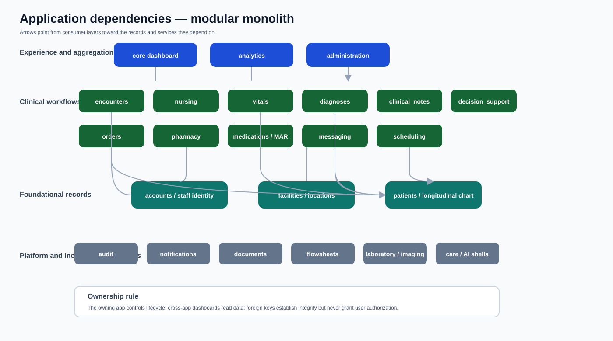
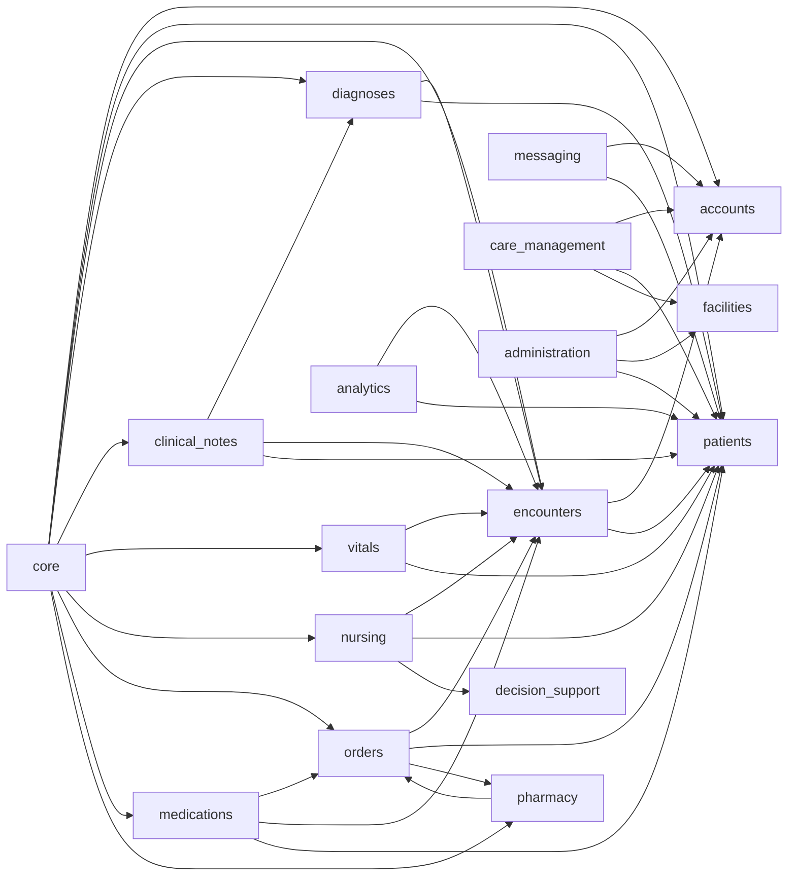
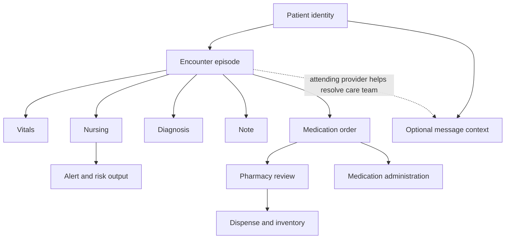
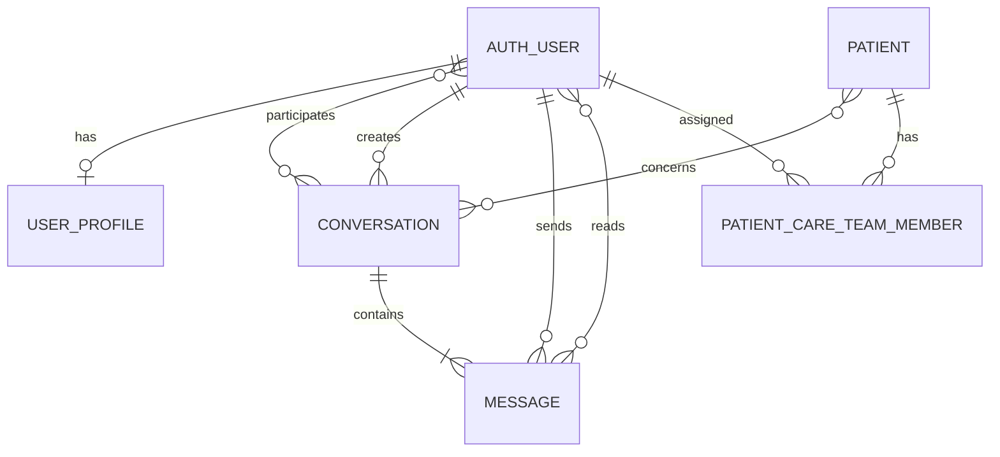

# Application dependencies and relationships

Liberia EHR is a Django modular monolith. A dependency can be a **hard dependency** (imports, models, forms, or services), a **read dependency** (dashboard/summary queries), or a **workflow dependency** (users move between apps). These meanings should not be confused with record ownership.

## Dependency graph

Arrows point from consumer to dependency. Django's built-in framework apps are omitted.

The SVG gives a presentation-oriented layered view; the Mermaid graph below records direct app relationships.

## Application catalog

| Application | Responsibility | Direct relationships | Maturity |
| --- | --- | --- | --- |
| `accounts` | User profile, staff role/title, password policy | Django user; facility assignment | Foundation |
| `facilities` | Facility, department, unit, room, bed | referenced by users, appointments, encounters | Foundation |
| `patients` | Longitudinal identity and demographic records | anchor for clinical apps | Implemented core |
| `encounters` | Episode-of-care lifecycle, provider, location | patient, provider, facility; reads notes | Implemented core |
| `nursing` | Assessments, tasks, I/O, handoffs, fall risk | patient, encounter, allergies, CDS | Implemented foundation |
| `vitals` | Observations, validation, history, trends | patient, encounter, recording user | Implemented |
| `diagnoses` | Terminology, diagnoses, procedures | patient, encounter | Partial foundation |
| `clinical_notes` | Draft/sign/amend/void documentation | patient, encounter, diagnoses/procedures, author | Implemented foundation |
| `orders` | Medication authorization and lifecycle | patient, encounter, pharmacy medication catalog | Implemented |
| `pharmacy` | Catalog, review, dispense, inventory | medication orders | Implemented foundation |
| `medications` | Patient and shift-wide medication administration records | orders, patients, encounters, administering users, care shifts | Implemented |
| `messaging` | Direct/broadcast chat and read state | user/profile, optional patients, care team | Implemented foundation |
| `care_management` | Time-bounded shifts, implicit multi-patient care teams, editable clinical-staff membership, workload ratios | accounts, patients, facilities, logout lifecycle | Implemented foundation |
| `decision_support` | Rules, alerts, recommendations, risk output | nursing and patient/encounter context | Unvalidated foundation |
| `administration` | Scheduling and configuration workspaces | accounts, facilities, patients | Mixed foundation |
| `analytics` | Clinical/operational read models | patients, encounters, other selectors | Foundation |
| `core` | Dashboard, shared helpers, shell aggregates | reads most implemented clinical apps | Aggregation layer |
| `laboratories`, `imaging` | Diagnostic workflow boundaries | intended patient/encounter/order links | Scaffold/partial |
| `documents` | Clinical document boundary | intended patient/encounter links | Scaffold |
| `flowsheets` | Reusable structured observations and longitudinal review | patients, encounters, recording users | Implemented foundation |
| `care_management` | Longitudinal care-management boundary | intended patient/team links | Scaffold |
| `notifications` | Future system-generated notices | separate from human staff chat | Scaffold |
| `audit` | Future centralized audit boundary | cross-cutting | Scaffold |
| `ai_assistant` | Future assistive boundary | no autonomous clinical workflow | Shell only |

## Clinical relationship chain

The patient is the longitudinal anchor. Encounter-linked records belong to a care episode; messaging can concern zero, one, or several patients.

## Messaging relationships

Conversation membership is the access boundary. Patient context does not grant access. Care-team assignments and encounter attending providers calculate broadcast recipients; the resolved participants are persisted.

## Dependency rules

1. The app that owns a record owns its lifecycle rules.
2. Cross-app mutations should use the owning app's forms or services.
3. A foreign key never implies authorization to view the related record.
4. Avoid cyclic imports with service boundaries, string model references, or carefully scoped local imports.
5. `core` and `analytics` should remain read-oriented aggregators.
6. Scaffolds must not become silent dependencies of safety-critical workflows.
7. System-generated notices belong to `notifications`; staff-authored communication belongs to `messaging`.

## Change-impact guide

| Change | Review these consumers |
| --- | --- |
| Patient archive/active rules | encounters, nursing, vitals, notes, orders, messaging, administration, dashboards |
| Encounter status/provider | patient summary, nursing discharge, orders, care-team resolution, analytics |
| Medication catalog | order forms, pharmacy review, dispensing, MAR display |
| Medication-order status | pharmacy queues, actionable MAR, patient view, dashboard |
| Medication frequency/next-due calculation | patient MAR time columns, recurrence expansion, Shift MAR prioritization |
| Care-team membership | assignment board, patient care-team display, staff workload/status, messaging recipient resolution |
| User profile role/title | provider labels, administration, messaging recipient eligibility/labels |
| Conversation participant rules | inbox, thread, polling, unread count, replies, read receipts |
| HTMX target/partial | full wrapper, initiating control, view selection, tests |

## Adding a dependency

- Classify it as hard, read-only, or workflow-only and identify the owner.
- Add authorization for the related object, database constraints, migrations, and lifecycle tests.
- Update this graph and [requirements.md](requirements.md).
- If it adds a fragment, document its pair in [htmx-rendering.md](htmx-rendering.md).
