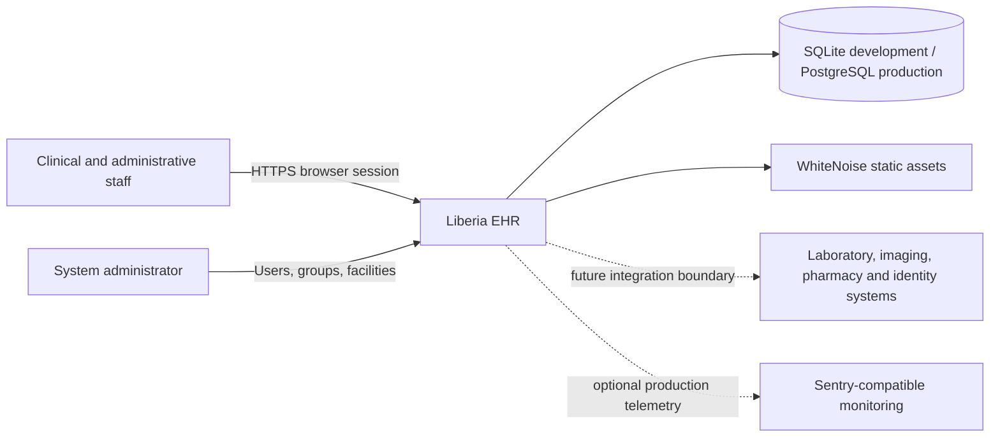
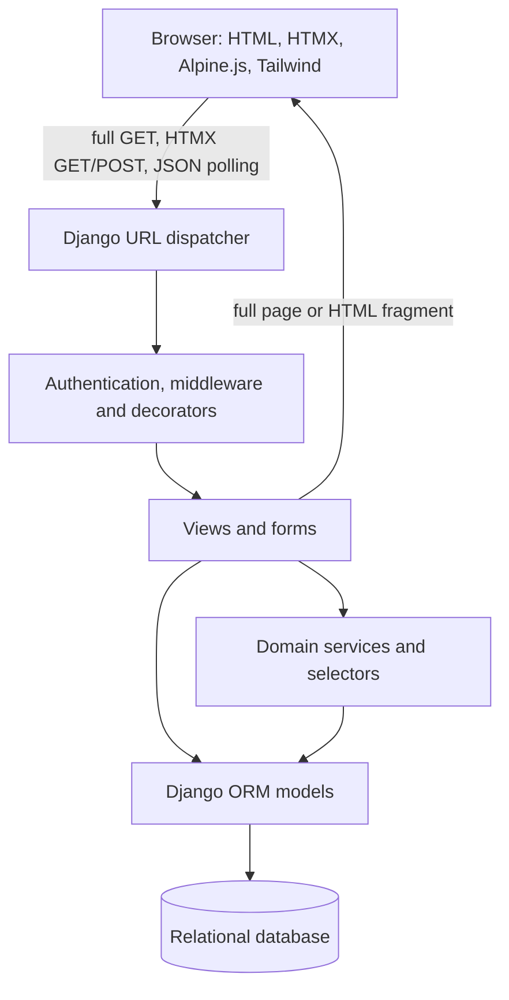
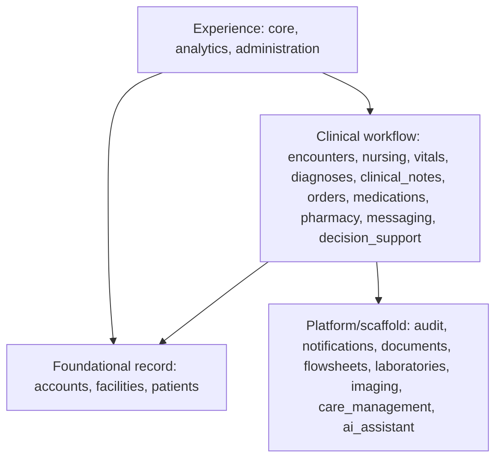
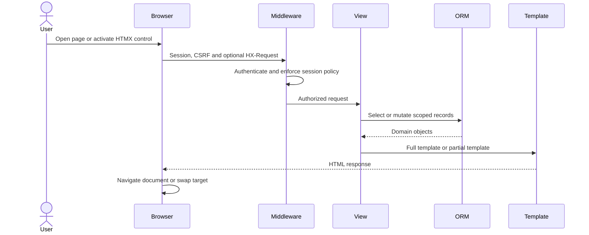
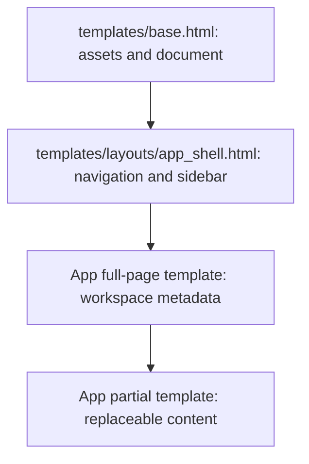

# System architecture

This document describes the implemented architecture of Liberia EHR. It is a developer guide, not a clinical certification or production-readiness claim. See [requirements.md](requirements.md) for requirement status and [htmx-rendering.md](htmx-rendering.md) for the rendering contract.

## Architectural goals

- Keep clinical state and authorization on the Django server.
- Preserve a longitudinal patient record across many encounters.
- Separate ordering, verification, dispensing, and administration records.
- Prefer auditable lifecycle transitions over destructive deletion.
- Deliver a compact interface with server-rendered HTML and targeted HTMX updates.
- Keep domain applications independently understandable while using explicit cross-app relationships.

## System context

External clinical integrations are not complete. The dotted connections identify boundaries, not active interfaces.

## Runtime containers

The application is a modular monolith. All Django apps run in one process and share one relational database. App boundaries organize ownership; they are not network-service boundaries.

## Application layers

Dependencies should generally point downward. `core` and `analytics` deliberately read across workflow apps to build dashboards. `nursing` creates decision-support records, so that workflow has an explicit cross-domain dependency documented in [application-dependencies.md](application-dependencies.md).

## Request and rendering lifecycle

For a normal request, the response includes the complete application shell. For `HX-Request: true`, participating views return only the fragment intended for the declared target. Both paths execute the same authentication, authorization, validation, and domain logic.

## Shared presentation shell

Full templates extend the shell and normally include the corresponding partial. A partial must be independently renderable inside its HTMX target and must not extend `base.html` or duplicate the navigation chrome.

## Domain boundaries and ownership

| App | Owns | Important consumers |
| --- | --- | --- |
| `accounts` | Staff profile and role metadata | encounters, administration, messaging, core |
| `facilities` | Facility, department, unit, room, and bed hierarchy | encounters, scheduling, administration |
| `patients` | Longitudinal identity and demographics | every patient-centered workflow |
| `encounters` | Episode of care, status, timing, provider, location | nursing, vitals, notes, diagnoses, orders |
| `orders` | Provider medication authorization | pharmacy, MAR, patient overview |
| `pharmacy` | Medication catalog, review, dispense, inventory | orders, MAR, dashboard |
| `medications` | Medication administration record | dashboard and patient views |
| `messaging` | Conversations, patient context, messages, read receipts | primary-navigation unread indicator |
| `decision_support` | Rules, alerts, recommendations, risk outputs | nursing and patient-facing clinical views |

The full app catalog and hard-import graph are in [application-dependencies.md](application-dependencies.md).

## Data and transaction principles

- Use timezone-aware timestamps and render them in the configured local timezone.
- Use database transactions for multi-record changes such as conversation creation and inventory decrement.
- Retain clinical history through status, amendment, void, archive, discontinue, or entered-in-error workflows.
- Treat foreign keys as integrity relationships, not sufficient authorization; views and services still scope accessible objects.
- Optimize cross-app read models with bounded queries before introducing a separate service.

See [database.md](database.md) for relationship diagrams and operational conventions.

## Security boundaries

1. The authenticated session identifies the user.
2. Middleware and decorators enforce broad access requirements.
3. Views and services enforce resource scope, participant membership, role, and workflow rules.
4. Forms validate user-supplied transitions and references.
5. CSRF protection covers state-changing browser requests.
6. Production transport must use HTTPS and secure cookies.

Hiding a link, button, sidebar item, or Alpine.js panel is presentation logic and is never an authorization control.

## Constraints and open work

- Unread messaging uses polling, so interval and query load need review at production scale.
- Several installed applications remain scaffolds and must not be presented as complete workflows.
- Object-level patient authorization needs a consistent service shared by all clinical apps.
- Laboratory, imaging, document, flowsheet, and interoperability boundaries require further design.
- Production readiness requires threat modeling, clinical validation, recovery testing, observability, and load testing.

## Related documentation

- [Project requirements](requirements.md)
- [Application dependencies](application-dependencies.md)
- [Application and web map](web-map.md)
- [HTMX rendering](htmx-rendering.md)
- [Database](database.md)
- [Permissions](permissions.md)
- [Clinical safety](clinical-safety.md)
- [Deployment](deployment.md)
