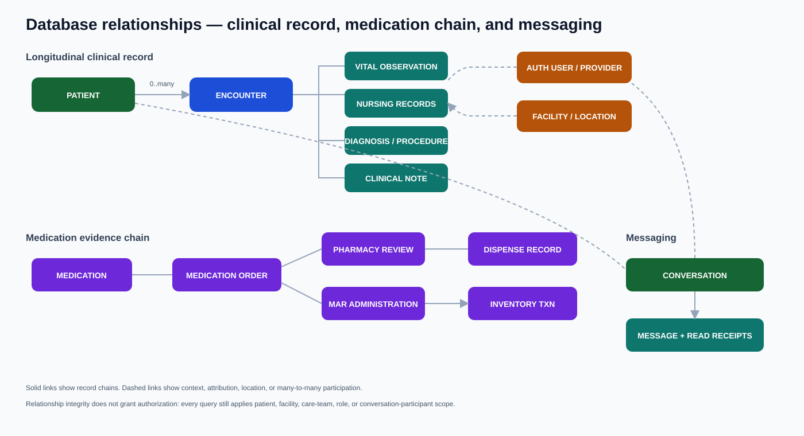
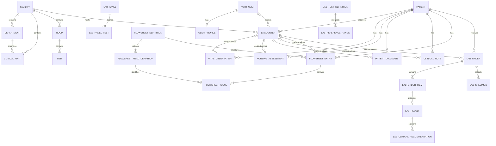
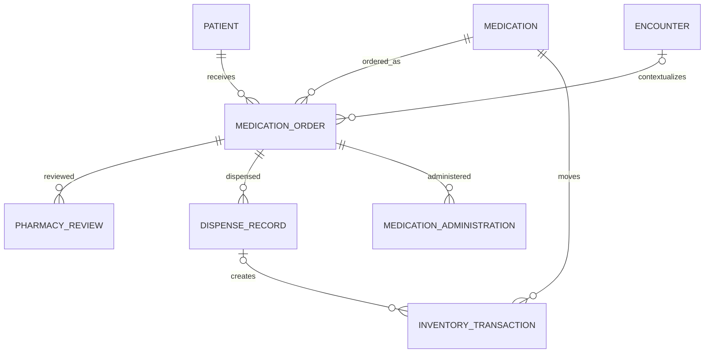
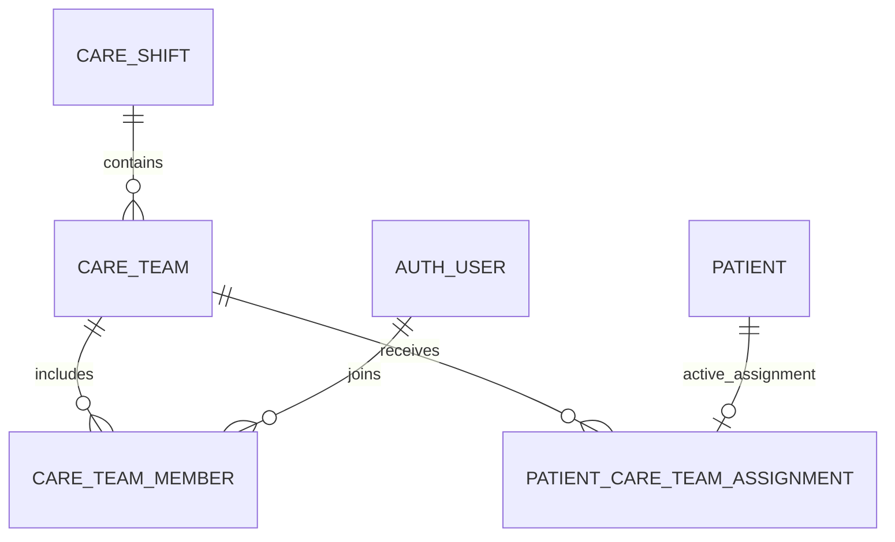
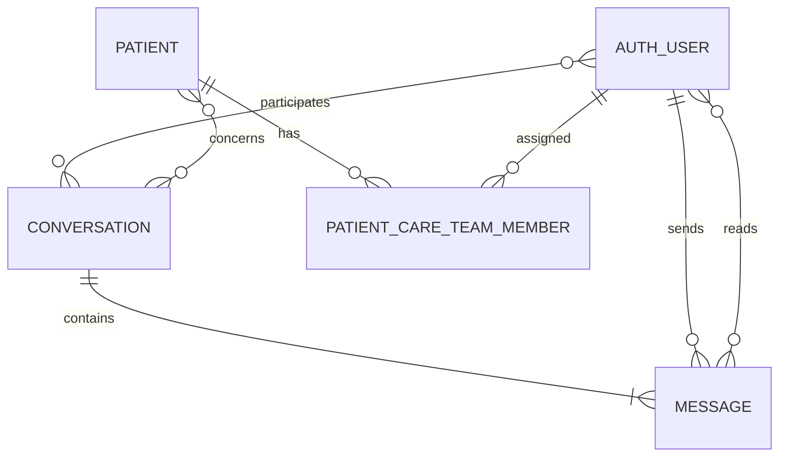

# Database architecture

Liberia EHR uses Django ORM models in one relational database. SQLite supports local development and automated tests; PostgreSQL is the production target for concurrency, constraints, reporting, backup, and recovery.

## Core relationships

[](diagrams/database-relations.svg)

The SVG combines the major clinical, medication, and messaging relationships. The Mermaid diagrams below separate them for detailed maintenance.



The patient is longitudinal. An encounter is one care episode and may be optional for records that can be documented outside a visit, where the model permits it.

Flowsheet definitions are reusable configuration records. Each signed entry captures a patient, optional validated encounter, recording user and time, with typed child values tied to ordered field definitions. Numeric fields can classify values as normal, warning, or critical using configured limits. Entries marked entered in error remain retained with the responsible user, timestamp, and reason.

## Medication chain



Catalog, order, pharmacy decision, stock movement, and bedside administration are distinct evidence records. They should never be collapsed into one mutable status row.

## Care-team assignment chain



`CareTeam` is created implicitly when a reviewed staff/patient batch is confirmed. A team can include multiple clinical staff and patients, and a shift can contain multiple teams. The conditional uniqueness constraint on active `PatientCareTeamAssignment.patient` enforces one active care team per patient. Released assignments remain historical records rather than being deleted.

## Messaging chain



Conversation participants authorize access. Concerned patients provide context. `Message.read_by` records per-user read state; it is not a substitute for a centralized immutable access audit.

## Integrity and lifecycle conventions

- Prefer database foreign keys, uniqueness constraints, check constraints, and indexes for invariants that the database can enforce.
- Validate workflow rules in forms/services as well; HTML inputs are not trusted boundaries.
- Use `transaction.atomic()` for multi-record changes that must succeed or fail together.
- Lock or conditionally update inventory rows during stock-changing operations.
- Archive, void, amend, discontinue, complete, cancel, or mark entered-in-error instead of hard-deleting clinical history.
- Define `on_delete` behavior deliberately. A cascade from reference/configuration data into clinical records is generally unsafe.
- Store timezone-aware datetimes and render in the configured application timezone.
- Add indexes for patient/encounter lookups, active/status queues, timestamps, unread queries, and other measured hot paths.

## Migrations

```bash
python manage.py makemigrations --check --dry-run
python manage.py migrate
python manage.py showmigrations
```

Commit schema and data migrations with the code that needs them. Review migrations for table rewrites, irreversible operations, unsafe defaults, and effects on retained clinical history. Rehearse large production migrations against representative PostgreSQL data and document rollback or forward-fix strategy.

## Environment expectations

| Environment | Database | Purpose |
| --- | --- | --- |
| Local development | SQLite by default | fast setup and feature work |
| Automated tests | isolated test database | repeatable verification; never development/production data |
| Staging | PostgreSQL matching production major version | migration, concurrency, recovery, and deployment rehearsal |
| Production | managed or operationally supported PostgreSQL | durable clinical workload after readiness approval |

SQLite passing tests does not establish PostgreSQL concurrency behavior. Transactional workflows, constraints, case-insensitive search, ordering, and migration behavior must also be tested on PostgreSQL before release.

## Backup and recovery requirements

- Define recovery point and recovery time objectives.
- Encrypt backups and restrict access separately from the live application.
- Test restoration into an isolated environment on a schedule.
- Verify schema, row counts, constraints, critical workflows, and audit continuity after restore.
- Document point-in-time recovery, key/secret recovery, retention, legal hold, and secure disposal.

## Data-access principle

A valid foreign key proves relationship integrity, not user permission. Every query returning patient, encounter, medication, or message data must apply the appropriate facility, role, care-relationship, or participant scope described in [permissions.md](permissions.md).

See [application-dependencies.md](application-dependencies.md) for app ownership and [requirements.md](requirements.md) for data, audit, security, and recovery requirements.
