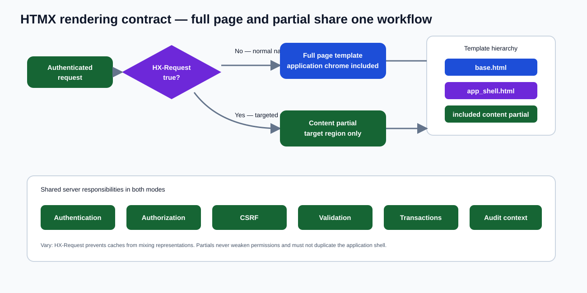
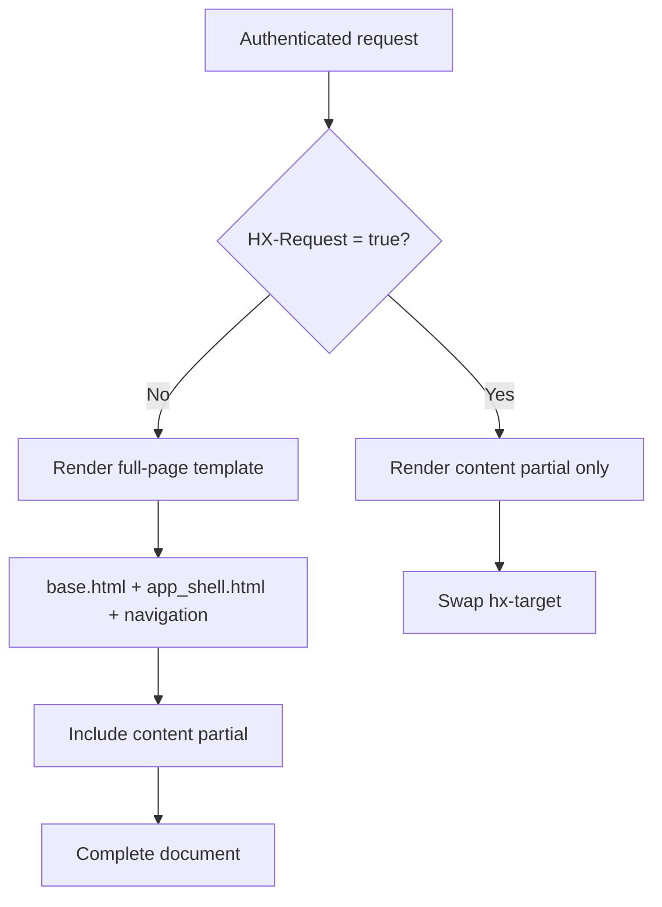
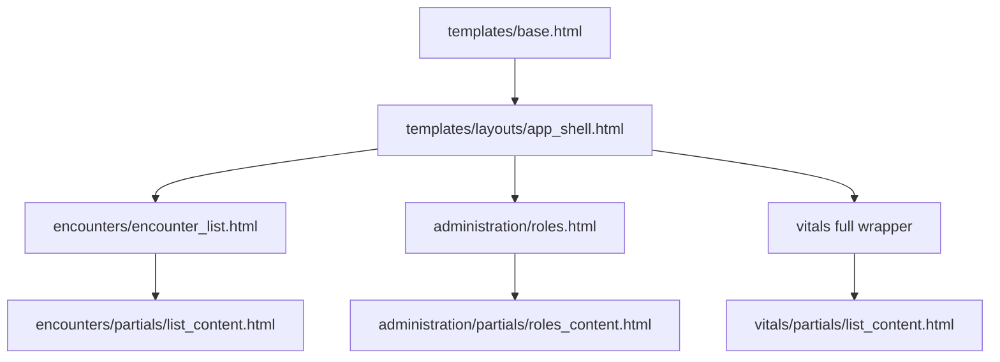
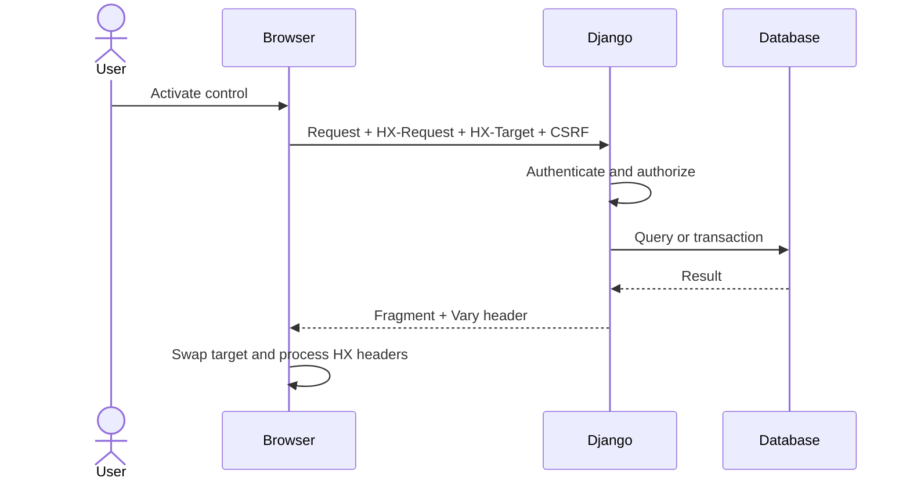
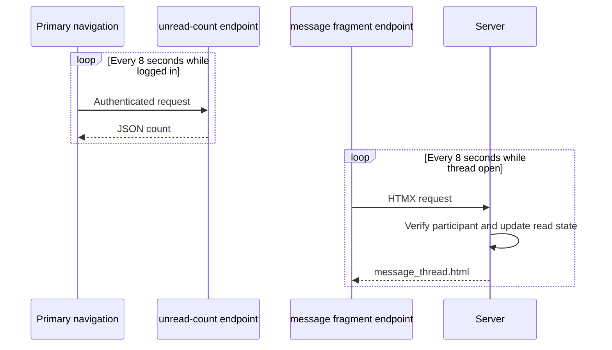

# HTMX full pages and partials

Liberia EHR uses progressive enhancement: primary workspaces have complete server-rendered pages, while selected interactions request smaller HTML fragments. Django owns authentication, authorization, validation, and clinical state in both modes.

## Core contract

| Request | Header | Response | Browser behavior |
| --- | --- | --- | --- |
| Normal navigation | no `HX-Request` | complete page and application shell | replace document |
| HTMX interaction | `HX-Request: true` | target-specific HTML partial | swap declared target |
| Unread poll | authenticated request | JSON unread count | update nav badge |
| Thread poll | `HX-Request: true` | message-thread fragment | refresh messages/read state |

`apps/core/htmx.py:is_htmx()` tests the header. Some older views contain local equivalents; new code should prefer the shared helper.

## Rendering decision

[](diagrams/htmx-page-partial.svg)

The SVG summarizes the rendering contract; the Mermaid source below shows the decision flow.



The two responses must expose equivalent domain information. Their difference is page chrome, not permissions or business rules.

## Template relationship



Full pages extend the shell and include their partial:

```django


  

```

Views return the partial only for HTMX:

```python
def get_template_names(self):
    if is_htmx(self.request):
        return [self.partial_template_name]
    return [self.template_name]
```

Responses that vary this way should set `Vary: HX-Request` so caches cannot confuse a fragment and a full page.

## Implemented page/partial families

| Area | Full page | Partial | Use |
| --- | --- | --- | --- |
| Encounters | `encounter_list.html`, `encounter_detail.html` | `partials/list_content.html`, `detail_content.html` | list/detail workspace |
| Patients | `patient_form.html`, `patient_detail.html` | `partials/patient_form.html`, `patient_detail.html` and overview fragments | chart and forms |
| Vitals | list/detail/form wrappers | `partials/list_content.html`, `detail_content.html`, `vital_form.html` | history/detail/forms |
| Clinical notes | note list/detail/form wrappers | matching `clinical_notes/partials/` files | navigation/forms |
| Administration | dashboard/users/roles/facilities wrappers | matching `administration/partials/*_content.html` | workspace replacement |
| Scheduling | list/detail/form wrappers | `administration/scheduling/partials/` | lists, forms, dependent choices |
| Facilities | list/detail/form wrappers | `facilities/partials/` | hierarchy and child forms |
| Analytics | dashboard wrappers | content, chart, and table fragments | filters/panels |
| Pharmacy | medication catalog wrapper | `medication_catalog_workspace.html` | catalog refresh |
| Messaging | conversation page | `messaging/partials/message_thread.html` | polling/read state |

Leaf fragments such as rows, fields, alerts, and search results should have one clear target contract.

## Interaction sequence



## Form rules

- Normal GET returns the full page; HTMX GET may return the form partial.
- Invalid POST returns identical validation errors in the correct wrapper.
- Valid POST redirects or issues an explicit HTMX navigation/swap instruction.
- CSRF, permissions, required fields, and clinical validation are identical in both modes.
- Dependent-select fragments do not replace server validation of submitted relationships.

## Messaging polling



Polling endpoints must be participant-scoped, non-cacheable where sensitive, and bounded for production load.

## Rules for new HTMX views

1. Build and test the full page first.
2. Extract the smallest coherent region into `partials/` and include it from the full page.
3. Return it directly only for `is_htmx(request)`.
4. Declare intentional `hx-target` and `hx-swap`; keep stable target IDs outside replaced inner content.
5. Preserve filters and patient/encounter context in URLs and forms.
6. Set `Vary: HX-Request` when representation changes.
7. Enforce authorization on fragments, search endpoints, and polling endpoints.
8. Test both rendering modes.

## Failure modes

| Symptom | Likely cause | Correction |
| --- | --- | --- |
| No navigation or apparently blank page | partial returned/opened as full page | return wrapper for non-HTMX request |
| Navigation duplicated inside card | full page swapped into target | return fragment for HTMX request |
| Content disappears | target was replaced/empty response | retain stable container and inspect response |
| Errors replace entire app | invalid HTMX POST rendered wrapper | return form partial with errors |
| Back/forward is stale | URL/history behavior undefined | preserve query state and use deliberate history |
| `%20` in route | template whitespace inside URL attribute | keep URL tags free of padding |
| Sensitive fragment leaks | missing object/participant check or caching | share authorization and set cache headers |

## Test matrix

Every pair should cover normal and HTMX GET, anonymous and unauthorized access, valid and invalid POST, cross-object identifiers, correct wrapper selection, `Vary`, and browser history/context preservation.

## Accessibility and resilience

- Prefer standard links/forms that remain meaningful without JavaScript.
- Respect reduced-motion preferences for polling indicators.
- Preserve focus and entered data after swaps and errors.
- Do not communicate unread or clinical status through color/flashing alone.
