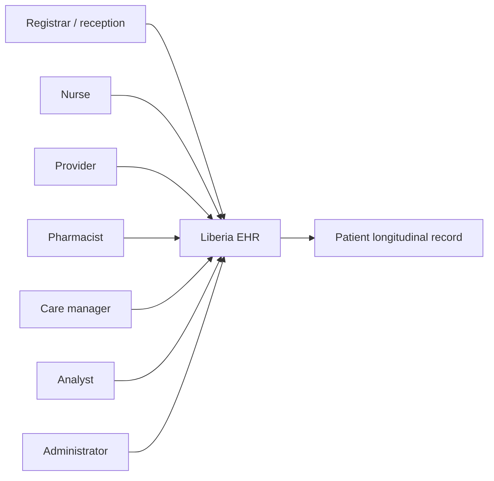
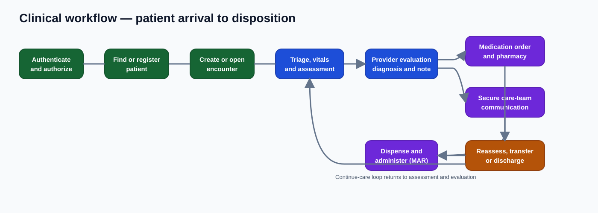
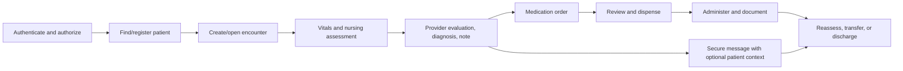
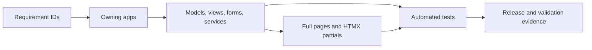

# Project requirements specification

This specification connects user needs to implemented Django applications and identifies incomplete work. **Implemented** means code exists in the development system; it does not mean clinically validated or production certified.

## Status legend

| Status | Meaning |
| --- | --- |
| Implemented | End-to-end foundation exists |
| Partial | Important behavior exists, but workflow/control is incomplete |
| Scaffold | Boundary exists without a complete workflow |
| Planned | Documented but not implemented |
| Validation required | Code exists but clinical, security, scale, or regulatory validation remains |

## Actors

Patients are record subjects in the current staff-facing system. A patient portal is not implemented.

## Primary workflow

The SVG is suitable for presentations and documentation portals; the Mermaid source below remains the editable logical definition.

## Functional requirements

### Identity, organization, patients, and encounters

| ID | Requirement | Owner | Status |
| --- | --- | --- | --- |
| IAM-01 | Authenticate staff with server-side sessions | `accounts` | Implemented |
| IAM-02 | Maintain name, role/title, facility, state, and password-change policy | `accounts`, `administration` | Implemented foundation |
| IAM-03 | Create permission groups and assign users | `administration`, Django auth | Implemented foundation |
| IAM-04 | Enforce permissions and resource scope on every clinical endpoint | all apps | Partial; review required |
| IAM-05 | Scope access by role, facility, department, care relationship, and audited emergency access | cross-cutting | Planned/partial |
| ORG-01 | Manage facilities, departments, units, rooms, and beds | `facilities`, `administration` | Foundation |
| PAT-01 | Register, search, update, archive, and restore patient charts | `patients` | Implemented |
| PAT-02 | Maintain identifiers, contacts, insurance, consent, allergies, and flags | `patients` | Foundation |
| PAT-03 | Preserve patient identity after discharge | `patients`, `encounters` | Implemented |
| ENC-01 | Manage encounter type, status, timing, location, provider, and reason | `encounters` | Implemented |
| ENC-02 | Require reason and intentional provider selection, including explicit N/A | `encounters` | Implemented |
| ENC-03 | Display provider full name and professional title | `encounters`, `accounts` | Implemented |
| ENC-04 | Prevent duplicate open encounters for a patient | `encounters` | Implemented |
| ENC-05 | Record status history and complete encounter at discharge | `encounters`, `nursing` | Foundation |

### Clinical documentation and decision support

| ID | Requirement | Owner | Status |
| --- | --- | --- | --- |
| VIT-01 | Record patient/encounter vital observations with local timestamps | `vitals` | Implemented |
| VIT-02 | Show history, abnormal values, corrections, and trends | `vitals` | Foundation |
| NUR-01 | Record admission, shift, focused, transfer, discharge, post-procedure, and change assessments | `nursing` | Foundation |
| NUR-02 | Manage tasks, I/O, handoff, and risk assessments | `nursing` | Foundation |
| CARE-01 | Create time-bounded shifts and assign patients to nurses or patient care aides | `care_management` | Implemented foundation |
| CARE-02 | Allow nurses and patient care aides to self-assign patients for a selected shift | `care_management` | Implemented foundation |
| CARE-03 | Show patient-to-nurse and aide-to-nurse ratios plus per-staff workload | `care_management` | Implemented foundation; staffing governance required |
| CARE-04 | Complete an assignment only after shift expiry and recorded staff logout | `care_management`, `accounts` | Implemented |
| DX-01 | Associate coded diagnoses/procedures with patient and encounter | `diagnoses` | Partial |
| NOTE-01 | Create, edit, sign, amend, void, list, and view notes | `clinical_notes` | Foundation |
| CDS-01 | Generate and acknowledge rules, alerts, recommendations, and risk scores | `decision_support` | Validation required |
| CDS-02 | Display provenance/version and require human judgment for predictive output | `decision_support`, `nursing` | Partial/validation required |

### Medication workflow

| ID | Requirement | Owner | Status |
| --- | --- | --- | --- |
| ORD-01 | Capture medication, dose, route, frequency, indication, prescriber, method, timing, and instructions | `orders` | Implemented |
| ORD-02 | Hold, discontinue, complete, and retain order history | `orders` | Implemented |
| PHA-01 | Review allergy, dose, route/frequency, interaction, and formulary concerns | `pharmacy` | Foundation/validation required |
| PHA-02 | Verify, reject, or request clarification with reason | `pharmacy` | Implemented |
| PHA-03 | Dispense against stock transactionally without negative inventory | `pharmacy` | Foundation |
| MAR-01 | Present scheduled/PRN orders and record outcomes | `medications` | Implemented |
| MAR-02 | Enforce timing/PRN checks and retain exception history | `medications` | Foundation |

### Secure messaging

| ID | Requirement | Owner | Status |
| --- | --- | --- | --- |
| MSG-01 | Show a visible primary-nav message control and unread count | `messaging`, shared templates | Implemented |
| MSG-02 | Send direct messages to one or more eligible staff | `messaging` | Implemented |
| MSG-03 | Broadcast to selected-patient care teams or eligible staff | `messaging` | Foundation |
| MSG-04 | Support general/patient context with one or more concerned patients | `messaging`, `patients` | Implemented |
| MSG-05 | Select context before subject and offer patient-specific categories | `messaging` | Implemented |
| MSG-06 | Show direction, sender, recipients, subject, patient context, body, time, and read state | `messaging` | Implemented |
| MSG-07 | Restrict threads, fragments, counts, and replies to eligible participants | `messaging` | Security review required |
| MSG-08 | Provide visible, motion-aware unread feedback | `messaging`, shared templates | Polling foundation |
| MSG-09 | End-to-end encryption or message-body encryption at rest | future architecture | Not implemented |

### Administration, analytics, and supporting domains

| ID | Requirement | Owner | Status |
| --- | --- | --- | --- |
| ADM-01 | Provide user, group, facility, scheduling, audit, settings, integration, and health workspaces | `administration` | Mixed foundation/scaffold |
| ANA-01 | Provide live operational aggregates for a selected period | `core`, `analytics` | Foundation |
| ANA-02 | Govern metric definitions, provenance, validation, and access | `analytics` | Partial |
| LAB-01 | Manage lab orders, specimens, and results | `laboratories` | Scaffold/partial |
| IMG-01 | Manage imaging orders and results | `imaging` | Scaffold/partial |
| DOC-01 | Manage patient/encounter documents and flowsheets | `documents`, `flowsheets` | Scaffold |
| INT-01 | Exchange standards-based data with external systems | future integration layer | Planned |

## Non-functional requirements

| ID | Requirement | Acceptance direction | Status |
| --- | --- | --- | --- |
| SEC-01 | HTTPS, secure cookies, CSRF, isolated secrets, least privilege | security review and configuration checks | Partial |
| SEC-02 | Prevent access using guessed/modified identifiers | negative tests for every object endpoint | Partial |
| AUD-01 | Attribute meaningful create/update/status/read events to user/time | durable audit evidence | Partial |
| DATA-01 | Preserve integrity and avoid destructive clinical deletion | constraints and lifecycle tests | Principle implemented; review required |
| DATA-02 | Use PostgreSQL for production concurrency and recovery | migration rehearsal and restore test | Deployment requirement |
| PERF-01 | Keep pages responsive and polling bounded | load model, budgets, test results | Not baselined |
| REL-01 | Tested backup, restore, downtime, and disaster recovery | approved RPO/RTO and exercises | Planned |
| UX-01 | Compact, readable, keyboard-accessible interface | accessibility and reduced-motion review | Partial |
| UX-02 | HTMX preserves context, errors, and full-page equivalence | full/partial test matrix | Partial |
| CLN-01 | Validate rules, risk models, medication safety, ownership, overrides | governance approval/version register | Required before production |
| OBS-01 | Monitor errors/health/security events without exposing PHI | production monitoring/log review | Partial/planned |

## Traceability

| Family | Routes/surfaces | Current evidence location |
| --- | --- | --- |
| IAM/ORG | `/accounts/`, `/administration/`, `/facilities/` | corresponding app tests and permission review |
| PAT | `/patients/` | patient workflow tests; coverage needs expansion |
| ENC | `/encounters/` | encounter view/form/model tests |
| VIT/NUR/NOTE/DX/CDS | app routes and chart workspaces | app tests plus clinical validation register |
| ORD/PHA/MAR | `/orders/`, `/pharmacy/`, `/medications/` | order, pharmacy, and MAR suites |
| MSG | `/secure-chat/` | `apps/messaging/tests/test_messaging.py` |
| ANA | `/analytics/` and `/` | selector/service/view tests plus metric validation |

Traceability is incomplete until every requirement has tests, applicable validation evidence, and an accountable owner.

## Gates before real clinical data

1. Approved privacy, security, and threat-model review.
2. Role/object authorization coverage and emergency-access policy.
3. Clinical validation of decision support and medication safety.
4. Central audit trail with retention and review procedures.
5. PostgreSQL, encrypted transport, managed secrets, backups, and successful restore exercise.
6. Accessibility, performance, concurrency, and failure-mode testing.
7. Incident response, downtime, recovery, and change control.
8. Data governance and jurisdiction-specific regulatory assessment.

## Explicitly incomplete or out of scope

- Patient portal and patient-authored messaging.
- End-to-end encrypted staff messaging.
- Complete laboratory, imaging, document, and flowsheet workflows.
- Production interoperability interfaces.
- Autonomous AI diagnosis, ordering, or treatment.
- Certification, formal clinical validation, or compliance attestation.

Update the requirement row, owner, status, and evidence whenever behavior changes. Relationships belong in [application-dependencies.md](application-dependencies.md); rendering contracts belong in [htmx-rendering.md](htmx-rendering.md).
