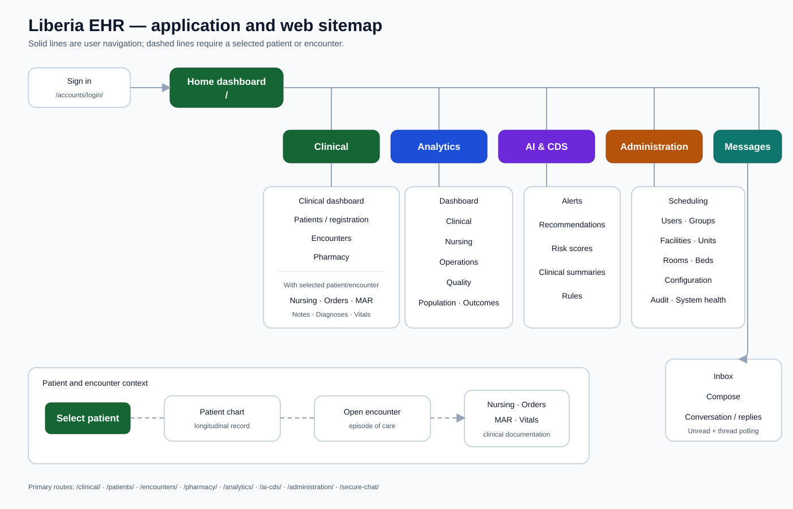
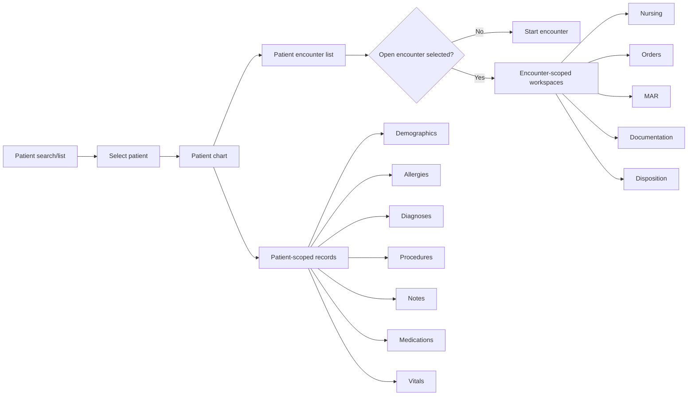
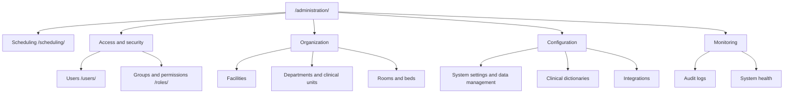
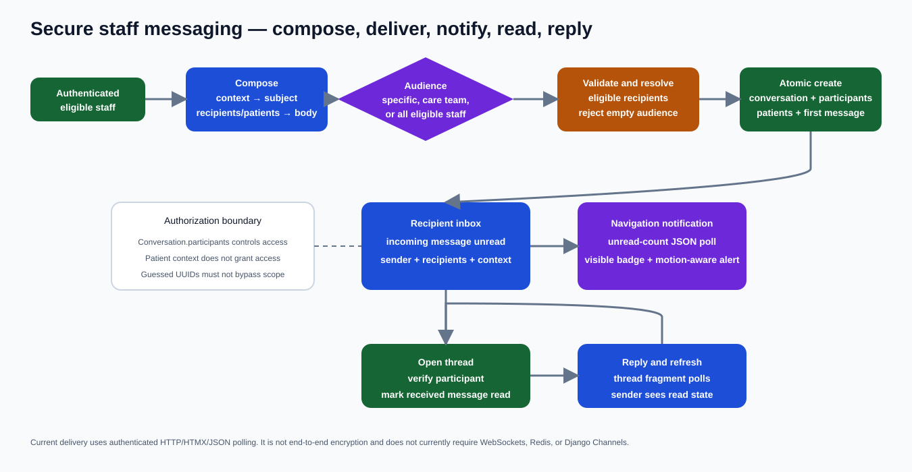
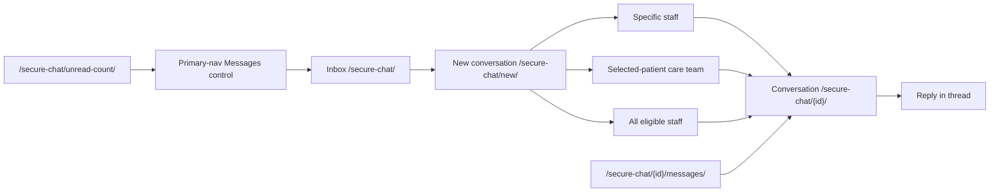
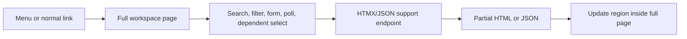

# Application and web map

This document maps the user-visible application, URL hierarchy, contextual clinical workspaces, and support endpoints. It complements the code dependency map in [application-dependencies.md](application-dependencies.md).

## Reading the map

- **Primary navigation** is directly reachable from the green application bar.
- **Contextual navigation** appears or becomes meaningful after selecting a patient or open encounter.
- **Workspace routes** are complete pages used for normal browser navigation.
- **Support routes** return HTMX fragments, JSON, dependent options, searches, or actions; they are not independent menu pages.
- Routes containing `<uuid>` or `<int>` require a real record identifier.

## User-facing application sitemap

The SVG above is the presentation-ready map. The Mermaid source below is retained as the maintainable structural definition.

```mermaid
flowchart TD
    Login["Sign in /accounts/login/"] --> Home["Home dashboard /"]

    Home --> Clinical["Clinical"]
    Home --> Analytics["Analytics"]
    Home --> CDS["AI & CDS"]
    Home --> Administration["Administration"]
    Home --> Messages["Messages /secure-chat/"]
    Home --> Profile["User profile /accounts/profile/"]

    Clinical --> ClinicalDash["Clinical dashboard /clinical/"]
    Clinical --> Patients["Patients /patients/"]
    Clinical --> Admission["Register / admission /patients/new/"]
    Clinical --> Encounters["Encounters /encounters/"]
    Clinical --> Pharmacy["Pharmacy /pharmacy/"]
    Clinical --> CareAssignments["Care assignments /care-management/"]

    Patients --> PatientChart["Patient chart /patients/{patient}/"]
    PatientChart --> PatientOverview["Overview"]
    PatientChart --> PatientEdit["Demographics and related records"]
    PatientChart --> PatientEncounters["Encounter history"]
    PatientChart --> Diagnoses["Diagnoses and procedures"]
    PatientChart --> Notes["Clinical notes"]
    PatientChart --> PatientMeds["Medication record"]
    PatientChart --> PatientVitals["Vital history"]

    PatientEncounters --> Encounter["Encounter /encounters/{encounter}/"]
    Encounter --> Nursing["Nursing workspace"]
    Encounter --> Orders["Medication order entry"]
    Encounter --> MAR["Medication administration record"]
    Encounter --> EncounterNotes["Encounter documentation"]

    Pharmacy --> Queue["Order queue and review"]
    Pharmacy --> Dispensing["Dispensing"]
    Pharmacy --> Inventory["Inventory"]
    Pharmacy --> Formulary["Medication formulary"]

    Analytics --> AnalyticsDash["Analytics dashboard /analytics/"]
    Analytics --> ClinicalAnalytics["Clinical analytics"]
    Analytics --> NursingAnalytics["Nursing analytics"]
    Analytics --> Operations["Operations"]
    Analytics --> Quality["Quality"]
    Analytics --> Population["Population health"]
    Analytics --> Outcomes["Patient outcomes"]

    CDS --> Alerts["Alerts"]
    CDS --> Recommendations["Recommendations"]
    CDS --> Risk["Risk scores"]
    CDS --> Rules["Rules - authorized staff"]

    Administration --> AdminOverview["Administration overview"]
    Administration --> Scheduling["Scheduling"]
    Administration --> Users["Users"]
    Administration --> Groups["Groups and permissions"]
    Administration --> Organization["Facilities, departments, units, rooms, beds"]
    Administration --> Configuration["Settings and dictionaries"]
    Administration --> Monitoring["Audit logs and system health"]

    Messages --> Compose["Compose /secure-chat/new/"]
    Messages --> Conversation["Conversation /secure-chat/{conversation}/"]
```

## Primary navigation map

| Primary area/control | Visible destination | Context-dependent destinations |
| --- | --- | --- |
| Home/logo | `/` | none |
| Clinical | `/clinical/`, `/patients/`, `/patients/new/`, `/encounters/`, `/pharmacy/` | nursing, medication orders, patient medications, MAR after selecting patient/encounter |
| Analytics | `/analytics/` | clinical, nursing, operations, quality, population health, outcomes |
| AI & CDS | `/ai-cds/` | alerts, recommendations, risk, rules depending on role |
| Administration | `/administration/` | scheduling, users, groups, organization, configuration, monitoring |
| Messages | `/secure-chat/` | compose, conversation, unread badge |
| User menu | `/accounts/profile/` | logout; Django administration for eligible users |

Desktop and mobile navigation expose the same major areas, though presentation differs.

## Patient-context map

### Patient-scoped routes

| Workspace | Route pattern |
| --- | --- |
| Patient chart | `/patients/<patient UUID>/` |
| Overview fragment/page section | `/patients/<patient UUID>/overview/` |
| Edit patient | `/patients/<patient UUID>/edit/` |
| Related records | `/patients/<patient UUID>/records/<kind>/` |
| Allergies | `/patients/<patient UUID>/allergies/.../` |
| Encounter list filtered to patient | `/encounters/?patient=<patient UUID>` |
| Diagnoses | `/diagnoses/patient/<patient UUID>/` |
| Procedures | `/diagnoses/procedures/patient/<patient UUID>/` |
| Clinical notes | `/clinical-notes/patient/<patient UUID>/` |
| Medication record | `/medications/patient/<patient UUID>/` |
| Reconciliation | `/medications/patient/<patient UUID>/reconciliation/` |
| Vital history | `/vitals/patient/<patient UUID>/` |

### Encounter-scoped routes

| Workspace | Route pattern |
| --- | --- |
| Start encounter | `/encounters/create/?patient=<patient UUID>` |
| Encounter summary | `/encounters/<encounter UUID>/` |
| Update/complete/cancel/error actions | `/encounters/<encounter UUID>/<action>/` |
| Nursing workspace | `/nursing/patient/<patient UUID>/encounter/<encounter UUID>/` |
| Medication order | `/orders/patient/<patient UUID>/encounter/<encounter UUID>/medication-order/` |
| MAR | `/medications/encounter/<encounter UUID>/mar/` |
| Encounter vital history | `/vitals/encounter/<encounter UUID>/` |

Patient and encounter identifiers must be validated as a matching pair on every route containing both.

## Administration map

The `/admin/` Django administration is a separate framework interface and is not the same as `/administration/`.

## Secure messaging map

The unread-count and message-fragment endpoints are support routes. They must not appear as standalone menu destinations.

## Route namespace inventory

| Prefix | Namespace/app | Main purpose |
| --- | --- | --- |
| `/` | `core` | authenticated home and departmental dashboard entry points |
| `/accounts/` | `accounts`, Django auth | login, logout, profile, password flows |
| `/patients/` | `patients` | longitudinal chart and related patient records |
| `/encounters/` | `encounters` | encounter lifecycle |
| `/nursing/` | `nursing` | patient/encounter nursing workspace |
| `/vitals/` | `vitals` | observation entry, history, detail, correction |
| `/diagnoses/` | `diagnoses` | diagnoses, procedures, terminology search |
| `/clinical-notes/` | `clinical_notes` | note list, create, detail, edit, sign |
| `/orders/` | `orders` | order list and medication entry |
| `/medications/` | `medications` | patient medication view, reconciliation, MAR |
| `/pharmacy/` | `pharmacy` | review, dispensing, inventory, formulary, terminology APIs |
| `/secure-chat/` | `messaging` | staff messaging and polling |
| `/care-management/` | `care_management` | shifts, patient-to-staff assignments, workload ratios |
| `/analytics/` | `analytics` plus a legacy `core` entry | analytics workspaces |
| `/ai-cds/` | `decision_support` | alerts, recommendations, risk, rules |
| `/facilities/` | `facilities` | facility hierarchy and dependent options |
| `/administration/` | `administration` | scheduling, access, organization, configuration, monitoring |
| `/admin/` | Django admin | framework administration for authorized staff |

## Full pages versus support endpoints

Examples of support-only endpoints:

- `/clinical/dashboard/` — clinical dashboard fragment.
- `/patients/search/` and `/facilities/search/` — search results.
- patient `/overview/` and `/sidebar/` — chart regions.
- facility and scheduling `/options/.../` — dependent dropdown options.
- diagnosis ICD-10/CPT search routes — terminology results.
- `/secure-chat/unread-count/` — JSON badge count.
- `/secure-chat/<conversation>/messages/` — polled thread fragment.
- pharmacy `/api/.../` — medication terminology/search/import helpers.

Support routes use the same authentication and object-scoping rules as full pages. See [htmx-rendering.md](htmx-rendering.md).

## Known navigation and routing concerns

- `/analytics/` is declared both as a `core` route and as the `analytics` app prefix. Because `core` is included first at the empty prefix, the exact `/analytics/` path resolves to the core view; deeper `/analytics/.../` paths resolve to the analytics app. This should eventually be consolidated.
- Several core department dashboards are placeholders or early foundations even though their routes exist.
- Patient-context controls should be disabled or omitted until a patient is selected; encounter-context controls require a valid open encounter.
- `/patient-portal/` is a placeholder route, not an implemented patient portal.
- The legacy directory `apps/liberia_ehr_patient_facility_htmx_views 2/` is not installed and is not part of this web map.

## Maintaining the map

When adding, moving, or removing a user-facing route:

1. Update the appropriate sitemap branch and route table.
2. Update desktop and mobile primary navigation together.
3. Identify whether the endpoint is a full page or support-only fragment/API.
4. Document required patient, encounter, facility, role, or participant context.
5. Test URL reversal, normal navigation, HTMX behavior, and unauthorized access.
6. Update [requirements.md](requirements.md) and [application-dependencies.md](application-dependencies.md) if ownership or scope changes.
